# SPARQ — Ignite the road.

A fictional electric-car showcase for Pakistan. Seven original concept models, a cinematic hero carousel, a configurator, a model comparison, a PKR savings calculator and a test-drive form, all in plain HTML, CSS and JavaScript.

**Team:** Ghunain Fayaz, Emaan Ferozi

> SPARQ is a fictional brand. All data, prices and specs are sample data. No real manufacturer logos, photos or brand assets are used.

---

## Screenshots

### Light theme

| Hero | The city |
|---|---|
| 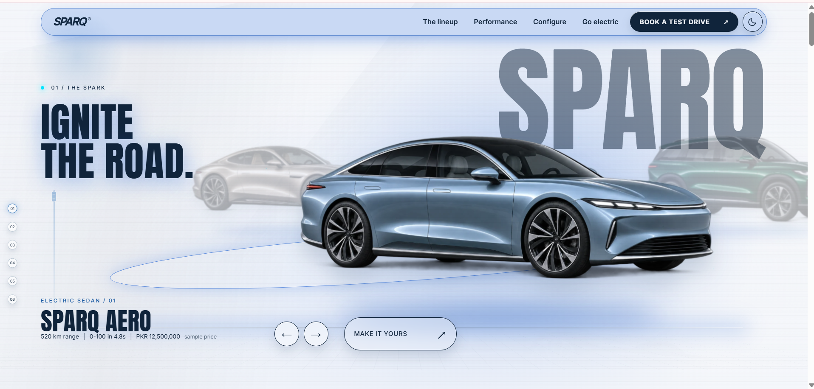 | 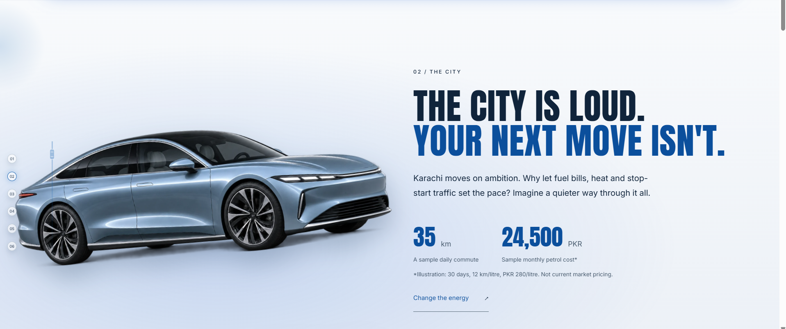 |

| Lineup: Aero | Lineup: Terra |
|---|---|
| 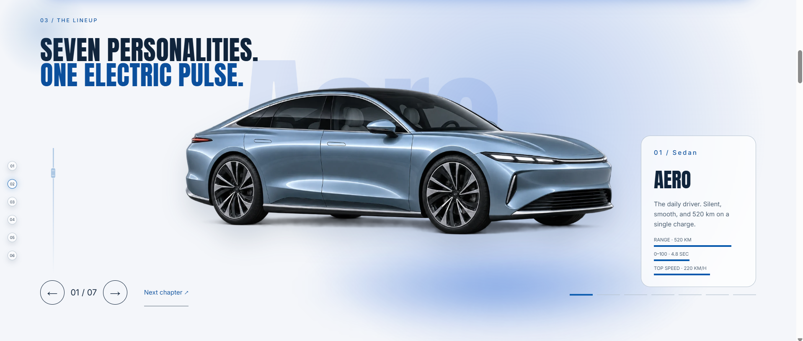 | 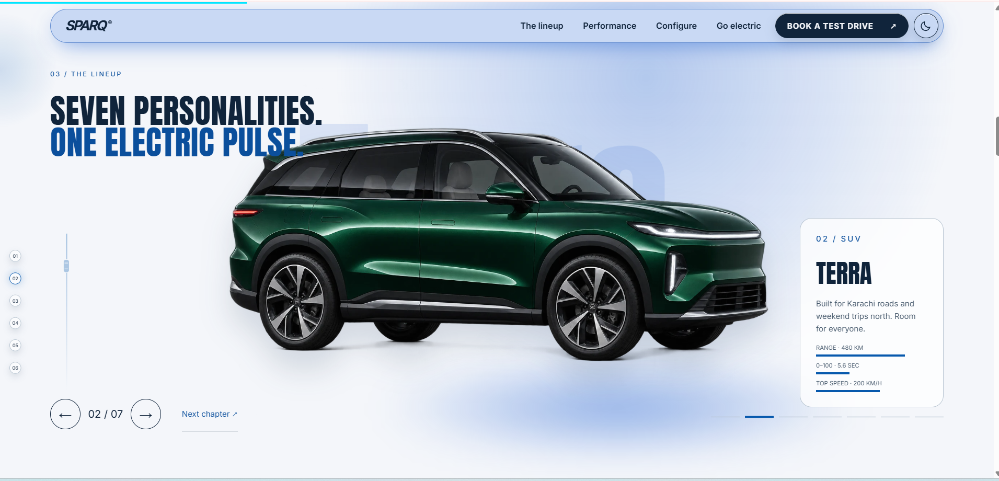 |

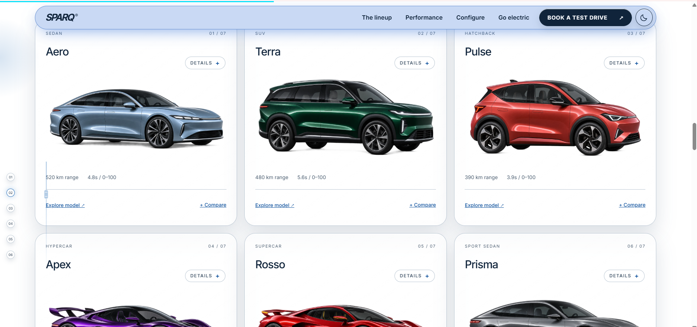

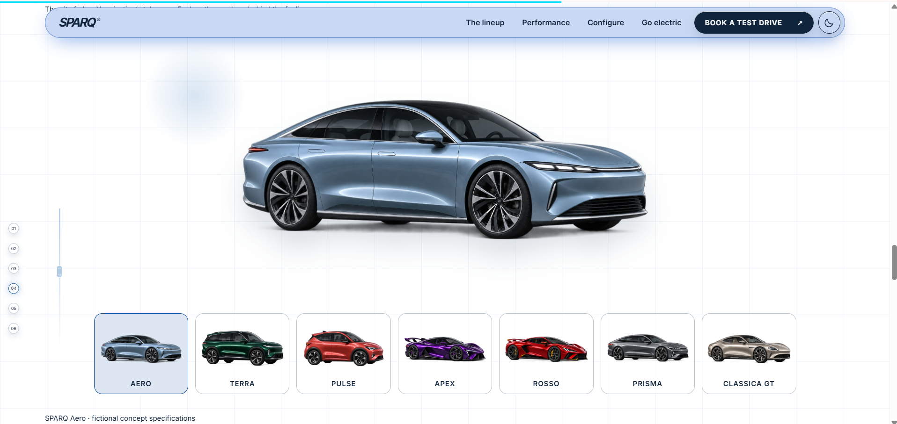

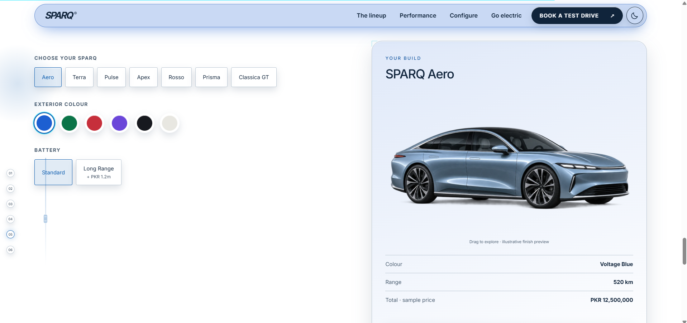

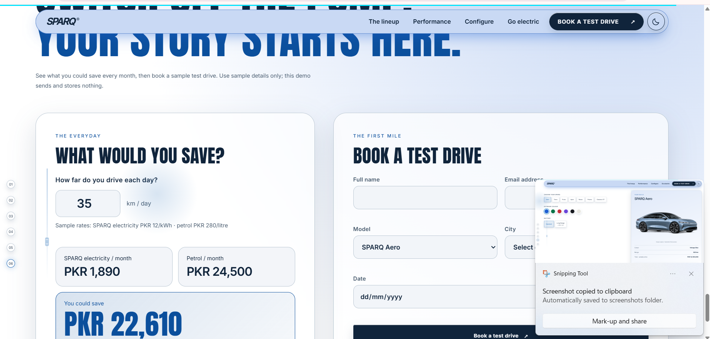

### Dark theme

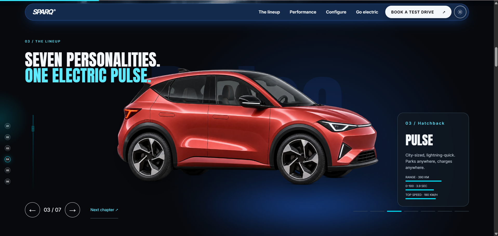

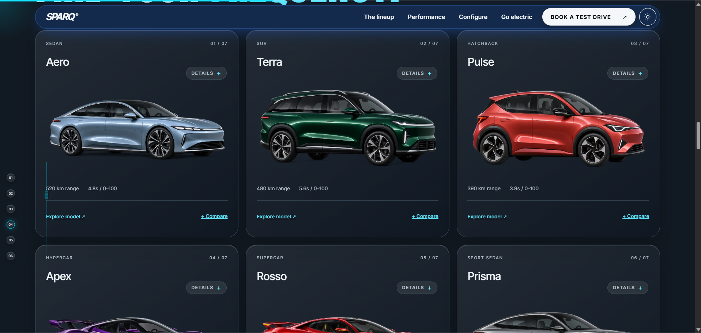

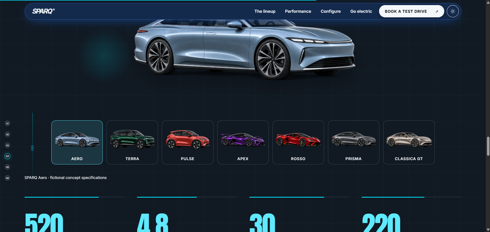

---

## Features

- **Hero carousel:** seven models with wraparound, arrow buttons, left/right keys and swipe. The accent color follows the active car, and cars tilt slightly with the mouse on desktop.
- **SPARQ wordmark:** large wordmark in the top right corner, under the navbar, behind the cars.
- **Story chapters:** six chapters with a fixed chapter rail and a scroll progress bar.
- **Lineup scene:** scroll-driven showcase with range, 0-100 and top speed bars for each model.
- **Collection:** cards for all seven models. Open a description with hover, tap or Enter.
- **Performance:** selectable model strip with animated stat counters.
- **Configurator:** pick a model, exterior color and battery (Long Range adds 16% range and PKR 1.2M) with a live build summary.
- **Compare:** select two models to open a side-by-side specification table. Escape closes it.
- **Savings calculator:** compares monthly EV and petrol cost from your daily distance.
- **Test-drive form:** frontend demo with validation. It stores and sends nothing.
- **Dark and light theme:** follows the system setting, saved after you switch.
- **Floating navbar:** a single pill tinted by the active car color, with a rounded dropdown on mobile.

## The lineup

| Model | Class | Range | 0-100 km/h | Top speed | Fast charge | Sample price (PKR) |
|---|---|---|---|---|---|---|
| Aero | Sedan | 520 km | 4.8 s | 220 km/h | 30 min | 12,500,000 |
| Terra | SUV | 480 km | 5.6 s | 200 km/h | 32 min | 14,800,000 |
| Pulse | Hatchback | 390 km | 3.9 s | 190 km/h | 25 min | 9,200,000 |
| Apex | Hypercar | 410 km | 2.4 s | 320 km/h | 22 min | 42,500,000 |
| Rosso | Supercar | 450 km | 2.8 s | 310 km/h | 24 min | 36,000,000 |
| Prisma | Sport sedan | 560 km | 4.2 s | 250 km/h | 28 min | 18,200,000 |
| Classica GT | Grand tourer | 590 km | 3.6 s | 280 km/h | 30 min | 28,500,000 |

Rosso, Prisma and Classica GT explore Italian supercar, German precision sedan and rounded grand-tourer design moods. They are original fictional designs, not real vehicles and not affiliated with any manufacturer.

## Tech stack

- HTML, CSS and vanilla JavaScript
- No framework, no backend, no build step, no runtime libraries
- Fonts: Anton and Inter, self-hosted in `assets/fonts` (SIL OFL)
- Images: seven original AI-generated transparent concept renders (WebP), plus a showroom background

## Run locally

Open `index.html` in a browser, or serve the folder:

```bash
python -m http.server 5174 --bind 127.0.0.1
```

Then visit http://127.0.0.1:5174.

## Deploy

Works as a static site on Vercel, Netlify or GitHub Pages. On Vercel, import the folder with the **Other** preset, leave the build command empty and use the project root as the output directory.

## Project structure

```
Zenova/
├── index.html
├── styles.css
├── script.js
├── README.md
├── screenshots/
└── assets/
    ├── car-1.webp ... car-7.webp
    ├── showroom.webp
    ├── generation-manifest.json
    └── fonts/
```

## Calculator assumptions

30 days per month, 0.15 kWh/km, electricity at PKR 12/kWh, petrol at PKR 280/litre and 12 km/litre. These are illustrative rates, not current market prices.

At 35 km/day: EV PKR 1,890, petrol PKR 24,500, difference PKR 22,610 per month.

## Accessibility and performance

- One `h1`, a skip link, visible focus states and keyboard support for the carousel, cards, compare dialog and form
- Text contrast checked in both themes
- `prefers-reduced-motion` turns off the intro, particles, parallax, tilt and animated transitions
- Lazy-loaded images with an inline SVG fallback if an image fails
- No horizontal overflow from 360 px phones to 1920 px screens

## Privacy

No accounts, payments, analytics or cookies. The test-drive form is a demo and nothing is submitted. Only the chosen theme is saved in the browser (`localStorage`).

## AI tools and credits

- **Codex:** implementation, car image generation and checks
- **Claude:** small layout edits (wordmark position) and documentation
- **Images:** original AI-generated artwork. The prompts are recorded in `assets/generation-manifest.json`
- **Fonts:** Anton and Inter via Fontsource

